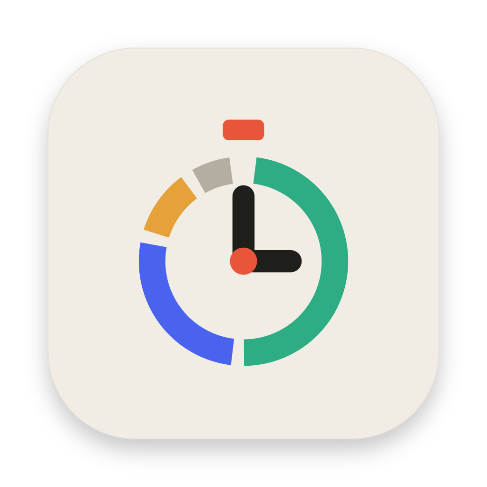
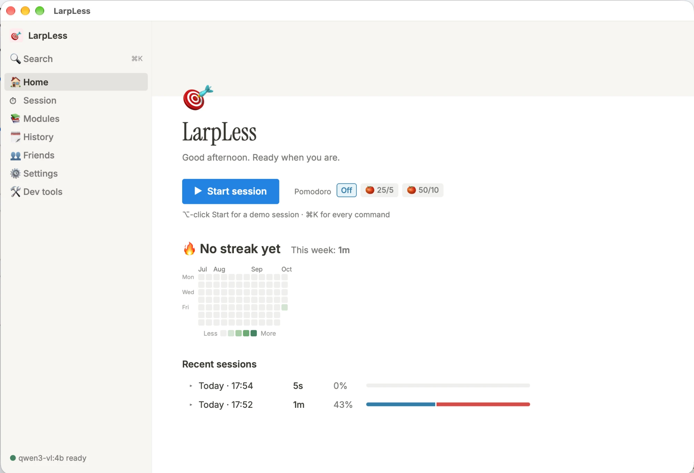
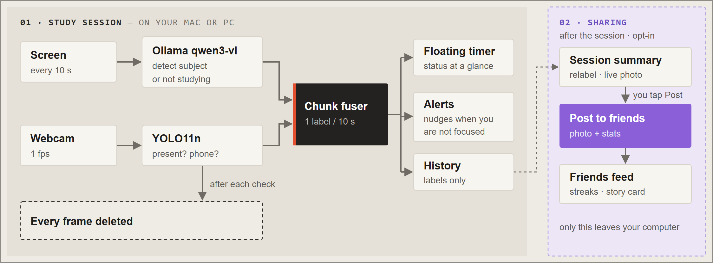
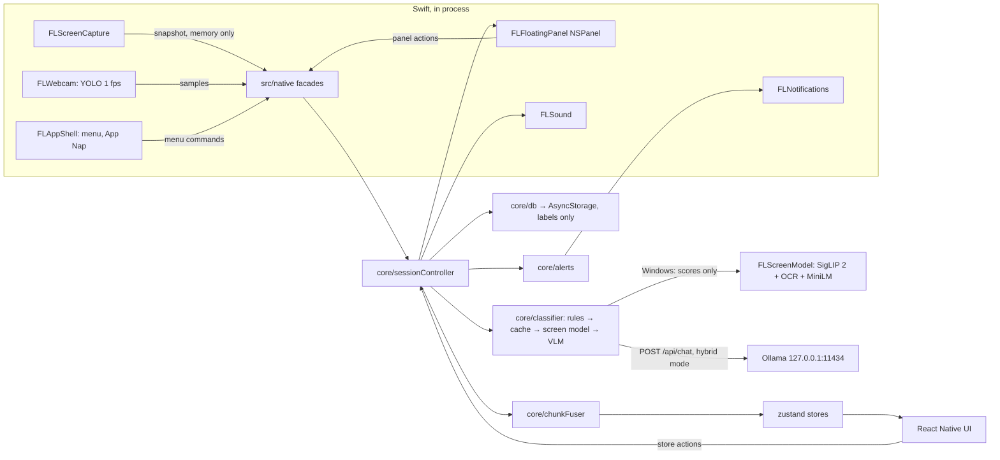

<p align="center"></p>

# LarpLess

<p align="center"></p>

**Strava for studying, as an app for your computer.** LarpLess watches your screen and webcam *on-device*, works out which subject you are studying or if you are distracted every 10 to 30 seconds, nudges you when you drift to Instagram on your screen or if you pick up your phone, and gives you a study session breakdown when you finish *(like Strava)*. If you want, you can then share the session stats with friends.

It was started in one hackathon day with **react-native-macos**. It also runs on **Windows 10/11** through react-native-windows, with C++ versions of the same native modules (see [Windows](#windows)).

> **Privacy first.** Frames are analysed in memory and dropped right away. Nothing is written to disk, and the only network call involving a frame goes to Ollama on `127.0.0.1`. Only labels such as "Biology, 10 s" are stored. The in-app privacy badge shows `Screenshots analysed: N · checks without a screenshot: M · stored: 0`, and on Pomodoro breaks the app stops capturing.

---

## Features

| | |
| --- | --- |
| **Subjects out of the box** | A built-in library of subjects with keywords sets the labels automatically. Adding your own courses is optional. |
| **Screen classification** | The frontmost app, the window title and (when needed) a screenshot go to a local vision model (`qwen3-vl:2b` via Ollama). It judges the *content*: a YouTube lecture counts as study, YouTube Shorts doesn't. |
| **Rules + cache fast path** | Known distractions (Instagram, TikTok, Reddit, Netflix, Discord, …) are flagged from the window title alone, and an unchanged window reuses the last verdict. Most checks need no screenshot. |
| **Power profiles** | Eco, Medium or High sets how often the screen is checked and how big the screenshot is. A session that falls behind steps down on its own, so slower Macs still get answers. |
| **Webcam presence & phone detection** | **YOLO11n** detects whether you are there and spots a phone, at 1 fps. CoreML on Mac, ONNX Runtime on Windows. |
| **Floating timer** | A SwiftUI `NSPanel` that floats over every app and Space. It shows green when you're studying, red when you're distracted, grey when you're away and blue on breaks. Hover it for Pomodoro, sound and session controls. |
| **Now playing** | A strip under the timer shows the current song, the time left, and previous / play / next. The title is shown, never saved. |
| **Pomodoro** | An optional study format of 25 minutes of focus and a subsequent 5 minute break or 50/10 is available. |
| **Escalating alerts** | Panel turns red → notification + soft chime → second notification + pulse. A "Back on track" flash when you return. Strictness: 2 / 5 / 10 min. |
| **Ambient sound** | White, pink and brown noise generated with `AVAudioEngine`, ducked during breaks. |
| **Session Summary** | Duration, focus %, subject breakdown bar, streaks and a heatmap. |
| **Friends feed** | Supabase accounts, friend requests and a feed of shared session stats. Posts include stats only. |
| **Demo mode** | Replays recorded chunks through the real store and panel, so the demo works offline with no Ollama and no camera. |

The UI is styled after Notion: Inter + Instrument Serif, the Notion tag palette, callouts, toggle lists, and a ⌘K command palette.

## How it works





The session controller runs two cycles: a **live** one every second that keeps the floating panel current, and a **chunk** of 10, 15 or 30 s (set by the [power profile](#power-profiles)) that records what you did. Both label the screen the same way.

### Labelling the screen

The classifier stops at the cheapest step that gives an answer:

1. **LarpLess in front:** reuse the previous verdict.
2. **Rules:** a distraction keyword in the app or window title → `distracted`. No screenshot.
3. **Cache:** same app and title as a verdict less than 2 min old → reuse it. No screenshot.
4. **On-device screen model (Windows):** when it's downloaded, SigLIP 2 image embeddings, Windows OCR and MiniLM text embeddings score the screen in about 0.5 s, with no Ollama involved. What happens next depends on the [screen check mode](#screen-check-modes).
5. **VLM:** take a screenshot and classify it with the vision model in Ollama (about 3 s on a fast Mac). Only one vision call runs at a time, and it is allowed to finish. A check for the same window shares its result. If you switched windows meanwhile, one follow-up reads whatever is in front when the call returns, so windows you only passed through are never captured.

### Screen check modes

On Windows, **Settings → Local AI → Screen check** chooses who reads the screen. The change applies from the next check, with no restart.

| | **On-device + Ollama** (default) | **On-device only** |
| --- | --- | --- |
| Study verdict | used at confidence ≥ 0.2, otherwise Ollama checks it | always used |
| "Not study" verdict | used at confidence ≥ 0.7, otherwise Ollama checks it | used at ≥ 0.6; below that the chunk is `unknown` (no alert) |
| Ollama | opened at session start, model warmed up | never opened, warmed up or asked |
| Model not downloaded | Ollama does every check | every chunk is `unknown` |

On-device only is for PCs where Ollama is too slow or uses too much memory. On the 39-screenshot bench the on-device model gets 95% of subjects right and tells study from distraction 39/39. The Mac has no on-device model yet, so it always uses Ollama and the setting is hidden there.

### Live: what the panel shows

- **Window changes:** every second the controller reads the frontmost app and title, which needs no screenshot. Once a new window has stayed in front for the profile's settle time (1 s on High, 2 s on Medium, 3 s on Eco), it is labelled straight away: within about half a second through a rule or the cache, about 3 s later through the VLM. Quick ⌘-Tabs (Alt-Tabs on Windows) are ignored, and a result for a window you have already left is dropped.
- **Webcam (1 fps):** `Away` after 5 s without you, `Phone` when it shows in 2 of the last 3 samples. While you are away, no window checks or screenshots happen.

### Every chunk: what is stored

1. **Webcam:** person absent for more than ⅔ of the chunk → `away`, with no screen check.
2. **Screen:** otherwise label the screen as above. This usually reuses the live check from the cache, so the chunk costs no extra screenshot.
3. **Fuse** the screen verdict with the chunk's webcam samples (phone visible for more than ⅙ → `distracted · phone`) into a `Chunk`, save it to the history and run the alerts, which escalate per chunk.

Failed or timed-out checks give `unknown`, which is left out of the focus %. A vision call may take up to 30 s. One that hits that limit pauses vision checks for one chunk, so a struggling Mac isn't handed the next screenshot straight away.

### Power profiles

Settings → Focus → **Power** picks how hard LarpLess works. Medium is the default.

| | Chunk | Settle | Screenshot | Cache | Ollama keep-alive |
| --- | --- | --- | --- | --- | --- |
| **Eco** | 30 s | 3 s | 768 px, JPEG 0.5 | 3 min | 5 min |
| **Medium** | 15 s | 2 s | 1024 px, JPEG 0.6 | 2 min | 15 min |
| **High** | 10 s | 1 s | 1280 px, JPEG 0.7 | 2 min | 30 min |

The keep-alive is how long Ollama keeps the model in memory after the last check. It only matters during long gaps such as Pomodoro breaks, because checks during a session keep resetting it.

The saved profile is a ceiling. If a vision call takes longer than a chunk, or you go through three different windows during one call (the one being checked included), the session steps down one level (High → Medium → Eco) and stays there until it ends. The step is not saved, so the next session starts at your chosen profile again.

### The model

Starting a session opens Ollama in the background if it isn't running, then warms the model up, which takes about 3 s while the first window settles, so the first check doesn't also wait for the model to load. LarpLess asks for a 4K context. The subject list sits in the system prompt, which is identical on every check, so Ollama reuses it and only processes the new screenshot and window line. Ending a session unloads the model to free its memory right away instead of waiting out the keep-alive.

**Memory saver.** Ollama 0.30+ runs models in llama.cpp's server, which keeps old prompts in a RAM cache of up to 8 GB. LarpLess never reuses one, so the cache only grows (about 340 MB per screenshot) and can push a 16–24 GB Mac into swap. Only `LLAMA_ARG_CACHE_RAM=0` in Ollama's environment at launch turns it off, so LarpLess applies it itself. It opens Ollama.app with that variable, and at app launch and session start it restarts an Ollama.app running without it, as long as no other model is loaded. Your own `OLLAMA_*` settings carry over. **Settings → Local AI → Memory saver** shows the state and has a **Restart Ollama** button. If you run the server yourself (a terminal or Homebrew), start it with `LLAMA_ARG_CACHE_RAM=0 ollama serve`.

**Layering:** `ui → store → core → native facades → Swift`. `src/core` is pure TypeScript with injected dependencies, so the whole session loop runs under Jest with fake timers.

## Tech stack

- **App:** react-native 0.81.6 + react-native-macos 0.81.9, TypeScript, Hermes. It runs Fabric + bridgeless; the legacy-style native modules work through the interop layer.
- **State / storage:** zustand 5, AsyncStorage 2.2.0 (pinned), date-fns 4.
- **Native (Swift 5, macOS 14+):** ScreenCaptureKit, AVFoundation, Vision, CoreML, UserNotifications, AppKit, SwiftUI.
- **Now playing:** a vendored [mediaremote-adapter](https://github.com/ungive/mediaremote-adapter) (BSD-3-Clause) run through `/usr/bin/perl`. Since macOS 15.4, a Developer ID app can't read MediaRemote itself.
- **Models:** Ollama `qwen3-vl:2b` and YOLO11n (`nms=True`, bundled; presence and phone). CoreML on Mac, ONNX Runtime on Windows. On Windows also SigLIP 2 base/16 (vision tower) and all-MiniLM-L6-v2 in ONNX Runtime for the on-device screen model.
- **Social:** `@supabase/supabase-js` + `react-native-url-polyfill`.
- **Website:** Vite + TypeScript in `site/`.
- **Windows:** react-native-windows 0.81 (C++ app, Fabric, WinAppSDK 1.8). Native modules in C++/WinRT: Direct2D + DirectWrite, XAudio2, MediaCapture, ONNX Runtime, WIC, toast notifications.

## Getting started on Mac

### Hardware Requirements

#### Minimum Requirements

- Mac with an apple silicon chip and 16 GB of RAM or more
- **macOS 14.5** Sonoma or above.

#### Recommended Requirements

This app relies on a VLM which is a GPU-intensive process. For a responsive experience, processors with strong GPU performance is needed. M-series chips that have more GPU cores which are the Pro, Max and Ultra lineups will perform much better than a regular M-series chip.
It is also worth considering that performance may degrade over time for MacBook Airs since they have no active cooling.

- Mac with Apple M4 or M1 Pro or M1 Max chip
- 24 GB of RAM or more

### Software Requirements

- **Xcode 16.1+**.
- **Node 22** or above.
- **Cocoapods** (`brew install cocoapods`).
- **CMake** (`brew install cmake`).
- **[Ollama](https://ollama.com)** to run the vision model. Onboarding installs it and downloads the model for you (see [First launch](#first-launch)); from a terminal it's `ollama pull qwen3-vl:2b`.

### Install

From `/larpless/`:

```bash
scripts/setup-worktree.sh
```

This runs `npm ci` and then `pod install` with the UTF-8 locale CocoaPods needs. If you run `pod install` yourself, `export LANG=en_US.UTF-8` first.

### Supabase Setup

The social layer reads `larpless/src/social/env.ts`, which is gitignored. The file has to exist so the app can build. Put the project URL and anon key there, or leave both empty and enter them in **Settings → Friends**. Settings override this file when both fields are filled in. If both are empty everywhere, the app skips Supabase and runs fully local.

```ts
export const SUPABASE_URL = 'https://<project>.supabase.co';
export const SUPABASE_ANON_KEY = '<anon key>';
```

Then, in the Supabase dashboard, run [`larpless/supabase/schema.sql`](larpless/supabase/schema.sql) in the SQL editor and turn off **Authentication → Providers → Email → Confirm email** (accounts use a username + password; you can also sign in with the email of an account made outside the app).

### Run

```bash
scripts/run-mac.sh 8081
```

This starts Metro on the port, builds the Debug app with that port baked in, and launches it. Each run opens a **new** app instance, so quit the previous one first:

```bash
pkill -f "$PWD/macos/build/Build/Products/Debug/LarpLess.app"
```

The Debug app is signed ad-hoc, so no Apple ID is needed, but macOS forgets its Screen Recording and Camera permissions after every rebuild. To keep them, sign with your own Apple Development certificate (**any Apple ID works**, via Xcode → Settings → Accounts → Manage Certificates). Create `larpless/macos/signing.local` (gitignored) and `run-mac.sh` picks it up:

```bash
CODE_SIGN_IDENTITY="Apple Development: Your Name (XXXXXXXXXX)"
DEVELOPMENT_TEAM=YOURTEAMID
```

`security find-identity -v -p codesigning` lists your certificate names; the team ID is the Organizational Unit in the certificate's details.

The Release configuration is set up for distribution: Developer ID signing for the LarpLess team, hardened runtime, and the camera entitlement from `LarpLess.entitlements`. Building it needs that team's **Developer ID Application** certificate. To build Release locally without it, override the identity:

```bash
xcodebuild -workspace macos/Focusline.xcworkspace -scheme Focusline-macOS -configuration Release -derivedDataPath macos/build CODE_SIGN_IDENTITY="Apple Development: Your Name (XXXXXXXXXX)" DEVELOPMENT_TEAM=YOURTEAMID build
```

### First launch

Onboarding takes four steps:

1. **Your modules.** Optional. LarpLess recognises the built-in subjects on its own; add your own courses (course codes, topics, lecturer names) for sharper labels.
2. **Permissions.** **Screen Recording** (macOS only applies it after a relaunch; the **Relaunch** button does that), **Camera** (optional: presence and phone detection) and **Notifications**.
3. **Ollama.** LarpLess checks whether Ollama is installed and running, and the page updates by itself.
   - Not installed: **Download Ollama** downloads `Ollama.dmg`. Open it and drag Ollama into Applications.
   - Installed but not running: **Open Ollama** starts it in the background, with the [memory saver](#the-model) on.
4. **AI model.** **Download model** pulls `qwen3-vl:2b` (about 1.9 GB) through Ollama with a progress bar. Cancel stops it, and the next download picks up where it left off. The download keeps going if you finish onboarding, and the sidebar shows its progress.

You can finish without Ollama or the model and set them up later: **Settings → Local AI** has the same **Open Ollama** and **Download model** buttons, and demo mode works offline. In dev builds, Settings → **Run onboarding again** shows it again.

### Getting Started on Windows

The Windows build uses the same TypeScript and the same JS ↔ native contract; only the native modules (`larpless/windows/LarpLess/Native/`) are C++ instead of Swift.

**Requirements**

- Windows 10/11 x64 with 16 GB of RAM or more.
- **Visual Studio 2026** (Community is fine) with the *Desktop development with C++* and *WinUI application development* workloads, the *MSIX Packaging Tools* component and the **Windows 11 SDK 10.0.22621**.
- **.NET SDK 10**, **Node 22** or above.
- **Developer Mode** on and **long paths** enabled (Settings → System → For developers).
- **[Ollama for Windows](https://ollama.com)** with `qwen3-vl:2b` pulled, as on the Mac. Not needed in the **On-device only** [screen check mode](#screen-check-modes), which only needs the on-device classifier (a one-time download of about 460 MB from onboarding or Settings → Local AI).

**Install and run.** From `larpless/`, run `npm ci`, create `src/social/env.ts` as in [Supabase Setup](#supabase-setup), then:

```powershell
powershell -ExecutionPolicy Bypass -File scripts\run-windows.ps1
```

This starts Metro on port 8081 if it isn't already running (log in `.logs/metro-8081.log`), restores the local PowerShell 7 tool the deploy step needs, then builds, deploys and launches the Debug app. The first build takes several minutes. No admin terminal is needed. Allow the camera when Windows asks; there is no Screen Recording permission on Windows. The first launch is mostly the same apart from those.

The script uninstalls the old app package first, and that deletes the app's local data, including the downloaded on-device classifier. After a JS-only change, don't rebuild: start Metro and relaunch the installed app (see `larpless/windows/CLAUDE.md`).

**Differences from the Mac app**

- Shortcuts use **Ctrl** instead of ⌘ (Ctrl+K palette, Ctrl+Enter start, Ctrl+. end).
- The on-device screen model and the [screen check modes](#screen-check-modes) exist only on Windows for now.
- The webcam uses the same YOLO11n rules as Mac (`person` above 0.5, `cell phone` above 0.4), through ONNX Runtime instead of CoreML. Samples start once the model has loaded.
- The main window uses Segoe UI, Georgia and Consolas, because react-native-windows can't load bundled fonts yet. The floating panel draws its own text and keeps Inter + Instrument Serif.
- Page transitions and other `Animated` effects are off on Windows (`ANIMATE` in `src/ui/platform.ts`): react-native-windows drops the content of a re-rendered `Animated.View`. The floating panel's tint, pulse and flash animations are native and unaffected.
- Closing the main window quits the app (the Windows convention) instead of keeping it in the background.
- During a session the app holds a Windows power request and opts out of EcoQoS, the counterpart of disabling App Nap.

### Demo mode

- **⌥-click Start** on Home, or ⌘K (Ctrl+K on Windows) → *Start demo session*: replays fixture chunks through the real store and floating panel.
- ⌘K → *Toggle demo fast mode*: short alert thresholds (20 s / 50 s instead of minutes). How often the screen is checked still follows the power profile.
- `node scripts/demo-social.mjs seed`: creates demo accounts with friendships and sample posts. Also `accept`, `request <user>` and `status`.

## Development

Run these from `larpless/`.

Type-check:

```bash
npm run typecheck
```

Run the Jest suites (`__tests__/core`, `social`, `ui`):

```bash
npm test
```

Clean previous macOS build products before a fresh native rebuild:

```bash
./scripts/clean-build.sh
```

Run this from `larpless/`. The cleanup script stops a running `LarpLess` app and removes `macos/build` plus matching Xcode `Focusline-*` DerivedData.

Build only:

```bash
xcodebuild -workspace macos/Focusline.xcworkspace -scheme Focusline-macOS -configuration Debug build
```

**Driving the running app from the shell.** `scripts/js-eval.mjs` connects to Metro's inspector, evaluates JS inside the app and prints JSON. `globalThis.__FL` exposes the native facades, the stores, `applyFixture`, `config` and the native test harnesses:

```bash
node scripts/js-eval.mjs 8081 "__FL.pingRoundTrip()"
```

Stream the JS console for 20 s (RN 0.81 no longer prints it in the Metro terminal):

```bash
node scripts/js-eval.mjs 8081 --console 20
```

Native logs use `os.Logger` under the subsystem `com.larpless.app`:

```bash
log show --last 5m --style compact --predicate 'subsystem == "com.larpless.app"'
```

**Classifier bench.** `node scripts/bench-classifier.ts --model qwen3-vl:2b` scores the prompt against `bench/<expected>__<desc>.png`. If that folder is empty it renders 10 synthetic mock-ups instead and never captures the real screen. Add `--clean` to delete the images afterwards.

**Adding native code.** `macos/Focusline-macOS/Native/` is an Xcode *synchronized folder*: drop files in and they join the target, with no `project.pbxproj` edits. Resources are flattened into the bundle, so prefix every type and file name (`FLCapture…`, `FLShell…`). The one exception is the **Bundle MediaRemote adapter** run-script phase in `project.pbxproj`: it calls `macos/scripts/build-mediaremote-adapter.sh`, which builds `macos/vendor/mediaremote-adapter` with CMake and copies the framework and the perl launcher into the app's Resources.

**Website.** The coming-soon page lives in `site/` at the repo root:

```bash
cd site && npm install && npm run dev
```

`npm run build` type-checks and writes the static site.

On Windows each module is one header in `windows/LarpLess/Native/` (`REACT_MODULE` / `REACT_METHOD` / `REACT_EVENT`). Include it in `LarpLess.cpp` and add a `ClInclude` to `LarpLess.vcxproj`. Files to ship with the app go in `windows/LarpLess/Assets/` as `<None … DeploymentContent="true">` items. To rebuild without the script (Metro already running), use `npx @react-native-community/cli run-windows --no-packager --logging`. Two quirks of the bridgeless runtime: `ReactContext::JSDispatcher()` is empty, so emit events directly (that's thread-safe), and blocking `.get()` on WinRT async calls must run off the UI (STA) thread.

## Privacy

- Screen and webcam frames stay in memory only. They never go to disk, AsyncStorage, temp files, logs, or the network (except local Ollama).
- Snapshots, base64 strings, pixel buffers and `CGImage`s are never logged. Logs carry sizes and timings only.
- Only labels are persisted. Window titles are never stored.
- The now-playing title and artist stay inside the Swift panel. They are never sent to JS, logged or stored, and the debug OCR scan skips the media strip. Settings keep only the on/off toggle and drop any key they don't know on load and on save.
- The now-playing helper is started with `--no-artwork`, so no album art passes through the app.
- `privacy.framesStored` is the constant `0`.
- Nothing is captured during Pomodoro breaks or while you're away.
