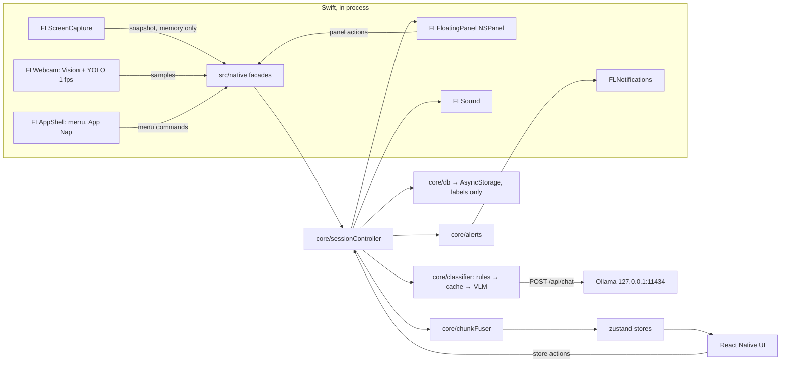

<p align="center"></p>

# LarpLess

**Strava for studying, as a native Mac app.** LarpLess watches your screen and webcam *on your own Mac*, works out which subject you are studying every 30 seconds, keeps a floating timer above every app, nudges you when you drift to Instagram or your phone, and gives you a per-subject breakdown when you finish. If you want, you can then share the session stats with friends.

It was built in one hackathon day with **react-native-macos**: one orchestrator ran four parallel Claude Code agents (plus a fifth for the social features), each in its own git worktree.

> **About the name:** the code still uses the working name **Focusline**. The `focusline/` folder, the `Focusline` Xcode workspace and the `com.focusline.app` bundle ID are real paths, so the commands below keep them.

> **Privacy first.** Frames are analysed in memory and dropped right away. Nothing is written to disk, and the only network call involving a frame goes to Ollama on `127.0.0.1`. Only labels such as "Biology, 30 s" are stored. The in-app privacy badge shows `Screenshots analysed: N · checks without a screenshot: M · stored: 0`, and on Pomodoro breaks the app stops capturing.

---

## Features

| | |
|---|---|
| 📚 **Subjects out of the box** | A built-in library of subjects with keywords sets the labels automatically. Adding your own courses is optional. |
| 🖥️ **Screen classification** | The frontmost app, the window title and (when needed) a screenshot go to a local vision model (`qwen3-vl:4b` via Ollama). It judges the *content*: a YouTube lecture counts as study, YouTube Shorts doesn't. |
| ⚡ **Rules + cache fast path** | Known distractions (Instagram, TikTok, Reddit, Netflix, Discord, …) are flagged from the window title alone, and an unchanged window reuses the last verdict. Most checks need no screenshot. |
| 📷 **Webcam presence & phone detection** | Apple Vision detects whether you are there and CoreML **YOLO11n** spots a phone, at 1 fps, natively. |
| ⏱️ **Floating timer** | A SwiftUI `NSPanel` that floats over every app and Space. It shows green when you're studying, red when you're distracted, grey when you're away and blue on breaks. Hover it for Pomodoro, sound and session controls. |
| 🍅 **Pomodoro** | 25/5 (with a long break), 50/10, a fast `demo` preset, or free timer. Breaks pause every capture. |
| 🔔 **Escalating alerts** | Panel turns red → notification + soft chime → second notification + pulse. A "Back on track" flash when you return. Strictness: 2 / 5 / 10 min. |
| 🎧 **Ambient sound** | White, pink and brown noise generated with `AVAudioEngine`, ducked during breaks. |
| 📊 **Summary & history** | Duration, focus %, subject breakdown bar, chunks you can relabel, streaks and a heatmap. |
| 👥 **Friends feed** *(Phase 2)* | Supabase accounts, friend requests and a feed of shared session stats. Posts carry stats only, never images. |
| 🎭 **Demo mode** | Replays recorded chunks through the real store and panel, so the demo works offline with no Ollama and no camera. |

The UI is styled after Notion: Inter + Instrument Serif, the Notion tag palette, callouts, toggle lists, and a ⌘K command palette.

## How it works



At every **chunk boundary** (30 s, or 10 s in demo-fast mode) the session controller resolves one label, stopping at the cheapest step that gives an answer:

1. **Webcam:** absent for more than ⅔ of the chunk → `away`. No screenshot.
2. **Active window:** if LarpLess itself is in front, reuse the previous verdict.
3. **Rules:** distraction keyword in the app or title → `distracted`. No screenshot.
4. **Cache:** same app and title as a verdict less than 2 min old → reuse it. No screenshot.
5. **VLM:** capture → classify (20 s timeout) → drop the frame in `finally`.
6. **Fuse** the screen verdict with the webcam samples (phone visible for more than ⅙ → `distracted · phone`) into a `Chunk`, then update the store, alerts, panel and history.

Failed or timed-out calls give `unknown`, which is left out of the focus %.

**Layering:** `ui → store → core → native facades → Swift`. `src/core` is pure TypeScript with injected dependencies, so the whole session loop runs under Jest with fake timers.

## Tech stack

- **App:** react-native **0.81.6** + react-native-macos **0.81.9**, TypeScript, Hermes. It runs Fabric + bridgeless; the legacy-style native modules work through the interop layer.
- **State / storage:** zustand 5, AsyncStorage 2.2.0 (pinned), date-fns 4.
- **Native (Swift 5, macOS 14+):** ScreenCaptureKit, AVFoundation, Vision, CoreML, UserNotifications, AppKit, SwiftUI.
- **Models:** Ollama `qwen3-vl:4b` (10/10 on the synthetic bench, p50 ≈ 3.2 s on an M4 Pro) and YOLO11n CoreML (`nms=True`, bundled).
- **Social:** `@supabase/supabase-js` + `react-native-url-polyfill`.
- **Deliberately not used:** react-navigation, Tailwind/NativeWind, reanimated, react-native-svg, expo-*. Their macOS support was uncertain, so the app uses a route store, `StyleSheet` + theme tokens, core `Animated`, and emoji.

## Getting started

### Requirements

- An Apple-silicon Mac on **macOS 14+**, with **Xcode** (signed in with an Apple ID so an *Apple Development* certificate exists) and **CocoaPods**
- **Node ≥ 20**
- **[Ollama](https://ollama.com)** running locally, with the vision model pulled:

```bash
ollama pull qwen3-vl:4b
```

### Install

From `focusline/`:

```bash
scripts/setup-worktree.sh
```

This runs `npm ci` and then `pod install` with the UTF-8 locale CocoaPods needs. If you run `pod install` yourself, `export LANG=en_US.UTF-8` first.

### Supabase (optional, for the Friends tab)

The social layer reads `focusline/src/social/env.ts`, which is gitignored. Create it:

```ts
export const SUPABASE_URL = 'https://<project>.supabase.co';
export const SUPABASE_ANON_KEY = '<anon key>';
```

Then, in the Supabase dashboard, run [`focusline/supabase/schema.sql`](focusline/supabase/schema.sql) in the SQL editor and turn off **Authentication → Providers → Email → Confirm email** (accounts use a username + password; you can also sign in with the email of an account made outside the app). If both values are empty, the app skips Supabase entirely and runs fully local.

### Run

```bash
scripts/run-mac.sh 8081
```

This starts Metro on the port, builds the Debug app with that port baked in, and launches it. Each run opens a **new** app instance, so quit the previous one first:

```bash
pkill -f "$PWD/macos/build/Build/Products/Debug/Focusline.app"
```

On first launch, grant **Screen Recording** (macOS needs an app relaunch afterwards; onboarding has a button for it), **Camera** and **Notifications**.

Switches in [`focusline/src/config.ts`](focusline/src/config.ts):

| Flag | Effect |
|---|---|
| `USE_MOCK_NATIVE` | `true` uses the JS mocks in `src/native/mock/` instead of the Swift modules |
| `USE_MOCK_CLASSIFIER` | `true` derives verdicts from the window title, with no Ollama |
| `CHUNK_S` / `DEMO_CHUNK_S` | Chunk length (30 s / 10 s) |

### Demo mode

- **⌥-click Start** on Home, or ⌘K → *Start demo session*: replays fixture chunks through the real store and floating panel.
- ⌘K → *Toggle demo fast mode*: 10 s chunks and short alert thresholds (20 s / 50 s).
- `node scripts/demo-social.mjs seed`: creates demo accounts with friendships and sample posts. Also `accept`, `request <user>` and `status`.

## Development

Run these from `focusline/`.

Type-check:

```bash
npm run typecheck
```

Run the Jest suites (`__tests__/core`, `social`, `ui`):

```bash
npm test
```

Build only:

```bash
xcodebuild -workspace macos/Focusline.xcworkspace -scheme Focusline-macOS -configuration Debug build
```

**Driving the running app from the shell.** `scripts/js-eval.mjs` connects to Metro's inspector, evaluates JS inside the app and prints JSON. `globalThis.__FL` exposes the native facades, the stores, `applyFixture`, `config` and the native test harnesses:

```bash
node scripts/js-eval.mjs 8081 "__FL.pingRoundTrip()"
```

Stream the JS console for 20 s (RN 0.81 no longer prints it in the Metro terminal):

```bash
node scripts/js-eval.mjs 8081 --console 20
```

Native logs use `os.Logger` under the subsystem `com.focusline.app`:

```bash
log show --last 5m --style compact --predicate 'subsystem == "com.focusline.app"'
```

**Classifier bench.** `node scripts/bench-classifier.ts --model qwen3-vl:4b` scores the prompt against `bench/<expected>__<desc>.png`. If that folder is empty it renders 10 synthetic mock-ups instead and never captures the real screen. Add `--clean` to delete the images afterwards.

**Adding native code.** `macos/Focusline-macOS/Native/` is an Xcode *synchronized folder*: drop files in and they join the target, with no `project.pbxproj` edits. Resources are flattened into the bundle, so prefix every type and file name (`FLCapture…`, `FLShell…`).

## Repository layout

```
.
├── README.md                 this file
├── CLAUDE.md                 rules for every agent: privacy, ownership, architecture
├── plan.md                   original product spec (written for a web app; the behaviour still applies)
├── brand/                    LarpLess logo, icon and wordmark
├── docs/macos/
│   ├── PLAN.md               macOS technical plan: stack, runtime loop, thresholds, demo script
│   ├── CONTRACTS.md          frozen types, native module APIs, store shape, design tokens
│   ├── ORCHESTRATOR.md       hackathon-day runbook
│   ├── agents/WS-*.md        one brief per workstream
│   └── status/WS-*.md        per-workstream progress, deviations and open requests
└── focusline/                the app
    ├── src/
    │   ├── contracts/        domain, native and store types
    │   ├── core/             pure TS: prompt, ollama, rules, classifier, chunkFuser, focus,
    │   │                     pomodoro, alerts, db, sessionController, demoMode
    │   ├── native/           typed facades over the Swift modules, plus mock/
    │   ├── store/            zustand: session, app, nav, social
    │   ├── social/           Supabase client and API
    │   ├── ui/               theme, components, layout, pages
    │   ├── fixtures/         demo and test data
    │   └── dev/              native harnesses and the __FL dev globals
    ├── __tests__/            Jest: core, social, ui
    ├── scripts/              run-mac, setup-worktree, js-eval, bench-classifier, demo-social
    ├── supabase/schema.sql   profiles, friendships, posts and RLS
    └── macos/Focusline-macOS/
        ├── Native/Capture/   FLScreenCapture, FLPermissions, FLWebcam + yolo11n.mlpackage
        ├── Native/Shell/     FLFloatingPanel (SwiftUI), FLNotifications, FLSound, FLAppShell
        ├── Native/Shared/    FLPing, bridging header
        └── Fonts/            Inter, Instrument Serif
```

## Workstreams and status

| WS | Area | Status |
|---|---|---|
| **A** | Native capture: permissions, active window, ScreenCaptureKit, webcam + Vision + YOLO | A1–A9 done. The live-camera checks need a person in front of the camera. Camera preview cut. |
| **B** | Native shell: floating panel, notifications, sound, App Nap, menu | B1–B8 done, B10 partly polished |
| **C** | Core logic: classifier, fuser, focus, pomodoro, alerts, db, session controller, demo mode | C1–C15 done, with tests |
| **D** | UI: theme, components, every page, ⌘K palette | D1–D11 done |
| **E** | Social (Phase 2): Supabase accounts, friends, feed, posting from Summary | P3 + P4 done. Story-card PNG and live photo cut. |

See `docs/macos/status/WS-*.md` for details and the open "needs a human" checks.

### Differences from the original spec

- **Native, not web:** ScreenCaptureKit replaces `getDisplayMedia`, Vision + CoreML replace MediaPipe, an `NSPanel` replaces Document PiP, and AsyncStorage replaces Dexie. The model is `qwen3-vl:4b` instead of `qwen2.5vl:3b`.
- **Posts carry stats only:** no photo and no storage bucket. One **Friends** tab replaces separate Feed and Profile pages.
- **Not built:** the 1080×1920 story-card export, the live photo and the rain/café loops (they were on the cut list).

## Privacy invariants

These are enforced by convention and checked during review (see [CLAUDE.md](CLAUDE.md)):

- Screen and webcam frames stay in memory only. They never go to disk, AsyncStorage, temp files, logs, or the network (except local Ollama).
- Snapshots, base64 strings, pixel buffers and `CGImage`s are never logged. Logs carry sizes and timings only.
- Only labels are persisted. Window titles are never stored.
- `privacy.framesStored` is the constant `0`.
- Nothing is captured during Pomodoro breaks or while you're away.
