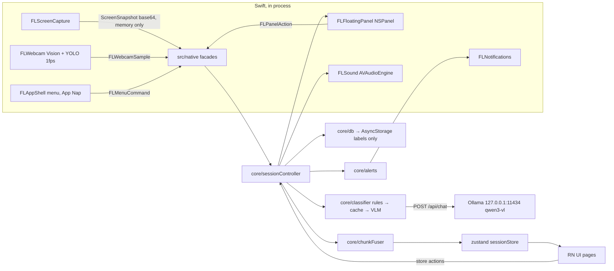

# Focusline for macOS: master technical plan

**Product:** the product spec in [`plan.md`](../../plan.md) is unchanged: "Strava for studying", on-device analysis, a Notion look, a floating timer, Pomodoro, ambient sound, a privacy badge, a story card.

**Platform change:** the app is now a **native Mac app in React Native (react-native-macos)**, built in **one hackathon day** by **one orchestrator running 4 parallel Claude Code agents** in git worktrees.

**Companion docs:**
- [CONTRACTS.md](CONTRACTS.md): frozen interfaces
- [ORCHESTRATOR.md](ORCHESTRATOR.md): runbook
- `agents/WS-*.md`: one brief per agent
- `status/WS-*.md`: live progress per agent

## 1. Locked decisions

| Topic | Decision |
|---|---|
| Scope | **Phase 1:** local core: sessions, classification, floating panel, Pomodoro, sound, alerts, local history. **Phase 2:** story card → live photo → Supabase posts/feed → friends. |
| Distribution | Dev build run from Xcode. No App Sandbox, no notarization, no hardened runtime. |
| Floating timer | Native **SwiftUI in an `NSPanel`**. JS pushes `PanelState`; the panel sends `PanelAction` back. |
| Screen classifier | **Hybrid.** Frontmost app + window title + screenshot go to the Ollama VLM. A **rules fast path** and a **cache** skip the screenshot whenever possible. |
| Webcam | Apple **Vision** for person presence + **CoreML YOLO11n** for the "cell phone" class, natively at 1 fps. |
| Agents | 1 orchestrator + 4 Claude Code agents (WS-A..D), plus WS-E in Phase 2. |
| Demo machine | M4 Pro, 24 GB, macOS 27.0.1, Xcode 27.0, CocoaPods 1.16.2, Node 26.10, Ollama 0.30.7. |

## 2. Stack

- **App:** `react-native-macos` **0.81.x** (latest patch) + matching `react-native` 0.81.x, TypeScript, Hermes.
  - Find the versions with `npm view react-native-macos@0.81 version` and `npm view react-native-macos@<ver> peerDependencies`.
  - If the Xcode 27 build is still broken after 20 minutes, switch to **0.83.x**.
- **Phase 0 findings (2026-10-09):**
  - **Versions:** react-native **0.81.6** + react-native-macos **0.81.9**.
  - **Architecture:** the macOS Podfile only enables Fabric when `RCT_NEW_ARCH_ENABLED=1`, so we run the **legacy architecture (bridge)** by default. That's the best fit for our `RCT_EXTERN_MODULE` modules.
  - **CocoaPods:** needs `LANG=en_US.UTF-8` (it crashes with an ASCII locale).
  - **Project format:** the Xcode project was upgraded to objectVersion 77 for the synchronized `Native/` folder, and it survives `pod install`.
  - **Xcode 27:** needs a pod deployment target ≥ 12, so the Podfile `post_install` forces 14.0.
  - **Debug code location:** in Debug builds the app code lives in `Focusline.debug.dylib`.
  - **YOLO11n export:** needed pinned versions (`ultralytics==8.3.170`, `coremltools==8.3.0`, `torch==2.6.0`, `numpy==1.26.4`). With the latest versions coremltools fails.
  - **JS logs:** they no longer reach the Metro terminal. Agents use `scripts/js-eval.mjs` (a CDP client) and `globalThis.__FL` for headless checks.
- **JS dependencies (Phase 0 only):** `zustand` 5, `@react-native-async-storage/async-storage` **2.2.0** (pinned; v3 vendors a new binary framework), `date-fns` 4. Jest (template).
- **Phase 2 adds:** `@supabase/supabase-js`, `react-native-url-polyfill`, `base64-arraybuffer`.
- **Banned:** react-navigation, NativeWind/Tailwind, reanimated, react-native-svg/lucide, expo-*. Their macOS or New Architecture support is uncertain; we use a route store, `StyleSheet` + tokens, core `Animated`, and emoji + Views instead.
- **Native:**
  - Swift 5 language mode, macOS 14.0 target.
  - Frameworks: ScreenCaptureKit, AVFoundation, Vision, CoreML, UserNotifications, AppKit, SwiftUI.
  - Modules are legacy-style (`RCT_EXTERN_MODULE` + `RCTEventEmitter`) and run under the New Architecture interop layer. Fallback: `RCT_NEW_ARCH_ENABLED=0 pod install`.
- **Native file layout:** `macos/Focusline-macOS/Native/{Shared,Capture,Shell,Social}/` is an Xcode **synchronized folder**, so agents add files without touching `project.pbxproj`.
- **Models:**
  - Ollama **`qwen3-vl:4b`** is the default; the WS-C bench compares it with `qwen3-vl:8b`.
  - **YOLO11n CoreML** (`nms=True`). Fallback: Apple's YOLOv3-Tiny CoreML model.
- **Signing:** Apple Development certificate (personal team), bundle id `com.focusline.app`. The stable signature keeps the Screen Recording and Camera grants across rebuilds.
- **Info.plist:**
  - `NSCameraUsageDescription`
  - `NSAppTransportSecurity → NSAllowsLocalNetworking = YES`
  - `ATSApplicationFontsPath = Fonts`
  - `LSMinimumSystemVersion = 14.0`

## 3. Web → macOS mapping

| plan.md (web) | macOS | Owner |
|---|---|---|
| `getDisplayMedia` + ImageCapture | `SCScreenshotManager.captureImage`: main display, own app excluded, no cursor, JPEG in memory → base64 | WS-A |
| *(new)* | Frontmost app via `NSWorkspace` + window title via `CGWindowListCopyWindowInfo` | WS-A |
| MediaPipe ObjectDetector | `AVCaptureSession` → 1 fps gate → `VNDetectHumanRectanglesRequest` + `VNCoreMLRequest`(YOLO) | WS-A |
| Document PiP + hover hub | `NSPanel` (`.nonactivatingPanel`, `.floating`, all Spaces) + SwiftUI `PanelView` with a hover hub | WS-B |
| Web Notifications | `UNUserNotificationCenter` + a `willPresent` delegate (banners while the app is in the foreground) | WS-B |
| Web Audio noise | `AVAudioEngine` + `AVAudioSourceNode` noise, synthesized chimes, optional `.m4a` loops | WS-B |
| Chrome background throttling | macOS **App Nap** → `ProcessInfo.beginActivity(.userInitiated)` during sessions | WS-B |
| `cmdk` | Native menu items (⌘K / ⌘↩ / ⌘.) → `FLMenuCommand` → RN palette overlay | WS-B + WS-D |
| Dexie | AsyncStorage via an injected KeyValue in `src/core/db.ts` | WS-C |
| `OLLAMA_ORIGINS` / CORS | Not needed in native code (only the ATS local-networking key) | Phase 0 |
| html-to-image story card | Phase 2: **SwiftUI `ImageRenderer`** renders the card natively to a PNG (`FLStoryCard`) | WS-E |

## 4. Repo layout (`focusline/`)

```
focusline/
  package.json  tsconfig.json  jest.config.js  index.js
  scripts/
    run-mac.sh            Metro on <port> + xcodebuild with RCT_METRO_PORT + open -n
    setup-worktree.sh     npm ci && pod install
    bench-classifier.ts   WS-C, run with: node scripts/bench-classifier.ts
    guard-ownership.sh    optional PreToolUse hook
  bench/                  gitignored test screenshots, deleted after the bench
  src/
    App.tsx               WS-D (Phase 0 version = dev tabs: Home placeholder | Harness A | Harness B)
    config.ts             orchestrator
    contracts/            orchestrator: domain.ts, native.ts, store.ts
    fixtures/             orchestrator: data.ts (pure), apply.ts (imports the store)
    native/               index.ts + mock/ (orchestrator); screen/permissions/webcam.ts (WS-A);
                          panel/notifications/sound/appShell.ts (WS-B)
    core/                 WS-C: prompt, ollama, rules, classifier, chunkFuser, focus, pomodoro,
                          alerts, db, sessionController, demoMode, ids
    store/                sessionStore.ts + appStore.ts (actions by WS-C), navStore.ts (WS-D)
    ui/                   WS-D: theme.ts, components/, pages/, layout/
    dev/                  HarnessA.tsx (WS-A), HarnessB.tsx (WS-B)
  __tests__/core/         WS-C
  macos/
    Focusline.xcworkspace
    Focusline-macOS/
      AppDelegate.*  Info.plist        orchestrator
      Fonts/                           TTFs (folder reference → Resources/Fonts)
      Native/                          synchronized folder
        Shared/   FLPing, bridging header      orchestrator
        Capture/  FLScreenCapture, FLPermissions, FLWebcam, Models/yolo11n.mlpackage   WS-A
        Shell/    FLFloatingPanel + PanelView, FLNotifications, FLSound, FLAppShell,
                  NotionColors, Sounds/   WS-B
        Social/   FLStoryCard + StoryCardView (Phase 2)   WS-E
  supabase/schema.sql     Phase 2, WS-E
```

## 5. Architecture



**Layer rule:** `ui → store → core → native facades → Swift`. `src/core` contains no `react-native` imports, so it is testable in Jest.

## 6. Session runtime loop (`src/core/sessionController.ts`)

`createSessionController(deps)` takes `{ native, db, store, getModules, getSettings, classify, now }` and is wired up in `src/store/sessionStore.ts`.

**`start(opts)`:**
1. Create the session.
2. `appShell.beginSessionActivity()`.
3. If webcam is enabled → `webcam.start({fps:1})` + subscribe to samples (ring buffer of the last 120 samples).
4. `panel.show()` + subscribe to actions.
5. `sound.play(settings.defaultSound)`.
6. Set the timer anchor and initialise the pomodoro (if not `'off'`).
7. Start the 1 s tick and the chunk scheduler.

**1 s tick:**
- Check the pomodoro phase against `phaseEndsAtMs`. On a phase change:
  - Notification + `chime('phase')`.
  - Breaks: tint blue, `sound.duck(0.3)`, `timer.runningSinceMs = null`.
  - Back to focus: restore everything.
- Push a `panel.update()` only when something changed. The panel ticks the clock itself.

**Chunk boundary** (every `CHUNK_S`; `DEMO_CHUNK_S` in demoFast). Skip if the status is not `running`.
1. **Webcam window:** take the samples in `[chunkStart, now)`.
   - Absent for more than 2/3 of the samples → `away`, `source:'webcam'`, `checksWithoutScreenshot++`. **No screenshot.**
2. **Active window:** `screen.getActiveWindow()`.
   - `isSelf` → reuse the previous screen verdict (or `unknown` if there is none). No screenshot.
3. **Rules:** `rules.match(appName, windowTitle)` → a distraction hit gives `{studying:false, activity:<site>, source:'rule'}`. `checksWithoutScreenshot++`. No screenshot.
4. **Cache:** same `appName` + `windowTitle` as the last VLM verdict, less than `CACHE_TTL_MS` ago → reuse it with `source:'cache'`. No screenshot.
5. **VLM:**
   - If a call is already in flight → `unknown`.
   - Otherwise `capture(CAPTURE)` → `classifyScreen(snapshot, modules)` → `framesAnalysed++`. Set the snapshot to `null` in `finally`.
6. **Fuse:** `fuseChunk({samples, verdict, durationS})` → `Chunk`.
7. Update the store (`chunks`, `current`).
8. `alerts.evaluate(...)` → panel tint, notification, chime, pulse, flash.
9. `panel.update()` and `db.appendChunk()`.

**Pause / resume:** freeze or unfreeze the timer anchor, and stop or restart the webcam to save power.

**`end()`:**
1. Finalise the partial chunk if it is ≥ 10 s.
2. `computeSummary`, then `db.saveSession`.
3. `panel.hide()`, `webcam.stop()`, `sound.play('off')`, `endSessionActivity()`.
4. `status = 'ended'` and `lastSummary` set. The UI then navigates to Summary.

**`relabelChunk`:** sets `source:'user'`, persists, and recomputes the summary.

## 7. Classification details

**Request:** `POST {ollamaUrl}/api/chat` with:

```json
{
  "model": "qwen3-vl:4b",
  "stream": false,
  "think": false,
  "keep_alive": "30m",
  "options": { "temperature": 0 },
  "format": "<schema>",
  "messages": ["system", "user with images:[base64]"]
}
```

**Schema:** `{studying:boolean, subject:enum[...moduleNames,"Not study"], activity:string, confidence:number}`, all fields required.

**System prompt** (`src/core/prompt.ts`):
- Judge the **content**, not the app. A lecture on YouTube, slides in Preview, notes in Notion and problem sets all count as study.
- Social media, messaging, games, shopping and entertainment video count as "Not study".
- Use the module keywords to pick the subject.
- The window title is a strong hint; when it conflicts with the screenshot, the screenshot wins.
- `activity` is at most 6 words describing what is visible.
- Answer with JSON only.

**User message:** `Frontmost app: …\nWindow title: …\nModules:\n- Biology: cell, mitosis, BIO101\n…`

**Timeouts and errors:**
- 20 s timeout via `AbortController`. A timeout or error → verdict `null` → chunk `unknown`, which is left out of the focus %.
- `checkHealth()`: `GET /api/tags` → `ok | down | modelMissing` → `store.ollama`.

**Rules list** (`src/core/rules.ts`, case-insensitive on `appName + ' ' + windowTitle`): instagram, tiktok, facebook, reddit, x.com, twitter, netflix, twitch, discord, whatsapp, messenger, steam, "youtube shorts", amazon.

Plain "YouTube" is **not** on the list, because it may be a lecture; the VLM decides.

## 8. Thresholds

| Thing | Normal | demoFast |
|---|---|---|
| Chunk length | 30 s | 10 s |
| Away | absent > 2/3 of the chunk's samples | same |
| Phone | phone visible > 1/6 of the chunk's samples | same |
| Alert level 1 (panel red) | first distracted chunk | same |
| Alert level 2 (notification + `chime('soft')`) | `strictness` min continuous | 20 s |
| Alert level 3 (2nd notification + pulse) | 2.5 × `strictness` | 50 s |
| Recovery | first subject chunk → level 0, `flash:'backOnTrack'`, `chime('back')` | same |
| Pomodoro 25/5 | 25 focus / 5 break / 15 long after 4 rounds | `demo` preset: 2 / 1 / 1 |
| Pomodoro 50/10 | 50 / 10, no long break | |
| Streak | consecutive days ending today or yesterday with a session where `totalS ≥ 15 min` | |

No alerts fire during breaks or while away.

## 9. Timeline (hackathon day)

| Time | What |
|---|---|
| Before the event | Environment prep only (see ORCHESTRATOR.md §1) |
| 2:20–2:50 | **Phase 0** (orchestrator): scaffold, contracts, mocks, fixtures, FLPing, scripts, build green, worktrees, launch agents |
| 2:50–3:30 | **Sprint 1** (table below) |
| 3:30 | **Checkpoint 1**: merge A → B → C → D, verify, agents merge `main` |
| 3:30–4:00 | **Sprint 2** |
| 4:00–4:20 | Lunch. **Checkpoint 2**: `USE_MOCK_NATIVE=false`, `USE_MOCK_CLASSIFIER=false`, first real E2E session |
| 4:20–5:15 | **Integration + polish.** WS-E (Phase 2) starts only if E2E is green by 4:40 |
| 5:15–5:25 | Rehearse `demoMode`, final polish |
| 5:25 | **Code freeze.** Rehearse the demo twice |

| Sprint | WS-A Native Capture | WS-B Native Shell | WS-C Core | WS-D UI |
|---|---|---|---|---|
| S1 | Permissions, active window, capture | Floating panel, notifications | prompt + ollama + **bench**, rules, classifier, fuser, focus | theme, primitives, layout, **Session page** |
| S2 | Webcam + Vision + YOLO | Sound, AppShell (App Nap, menu) | pomodoro, alerts, db, sessionController, demoMode | Onboarding, Home, Summary, History, Modules, Settings, palette |
| Integration | Robustness, camera preview (stretch) | Hover hub polish, Expand (stretch) | Bug fixes with the orchestrator | Motion polish, empty states |

## 10. Cut order (cut the top item first)

1. Rain/cafe loops (keep generated noise)
2. Webcam preview view (keep the status dot)
3. Panel "Expand" view
4. Dark mode
5. ⌘K palette (keep the menu items)
6. Custom Pomodoro presets (keep 25/5)
7. History heatmap
8. YOLO phone detection (keep presence)
9. Chunk relabelling
10. Phase 2 after the story card

**Never cut:** the live Session page, the floating panel with green/red status, screen classification, the privacy badge.

## 11. Risks → fallbacks

| Risk | Fallback |
|---|---|
| RN macOS 0.81 + Xcode 27 build break | Pre-event smoke test; switch to 0.83.x |
| TCC grants reset on every build | Stable Apple Development signing; `tccutil reset ScreenCapture com.focusline.app`; Screen Recording needs a **relaunch** (`permissions.relaunch()`) |
| Interop module or events fail under the New Architecture | `RCT_NEW_ARCH_ENABLED=0 pod install` |
| App Nap throttles JS timers | `beginSessionActivity()` during sessions |
| VLM too slow | 4b → 1024 px → 60 s chunks; rules and cache already skip most calls |
| YOLO export fails (Python 3.14) | `uvx --python 3.12 …`, or Apple YOLOv3-Tiny |
| Panel buttons need focus | `.nonactivatingPanel` + an `NSHostingView` subclass with `acceptsFirstMouse = true` |
| No banner while the app is in the foreground | `UNUserNotificationCenterDelegate.willPresent → [.banner, .sound]` |
| Synchronized folder or CocoaPods trouble | Pre-create every stub file from the briefs in Phase 0 |
| Metro port override fails | Native agents build only; the orchestrator runs the app |
| Something breaks live | `demoMode`: ⌥-click Start or the Settings toggle replays `fixtureChunks` through the real store and panel |

## 12. Demo script (2 min)

1. Start a session with Biology slides open → the callout and panel show **Biology**.
2. Switch to a maths PDF → a new blue segment grows in the breakdown bar.
3. Open Instagram → the panel turns **red** "Distracted · Instagram" within 1 chunk (rules fast path, no screenshot). In demoFast, a notification follows after 20 s.
4. Pick up the phone → flagged as distracted (phone).
5. End → Summary → relabel one chunk. In Phase 2: story card PNG and post.
6. Close on the privacy badge: "Screenshots analysed: N · checks without a screenshot: M · stored: 0. On breaks, it stops looking."

## 13. Verification

- **Each merge:** `npm run typecheck`, `npm test`, `xcodebuild … build`.
- **Each workstream:** the acceptance checklist in its brief.
- **E2E on the M4 Pro:** run the demo script above with `USE_MOCK_*=false`, plus a Pomodoro `demo` break during which `framesAnalysed` doesn't increase.
- **Privacy:**
  - `grep -rn "console\.\(log\|warn\)" src | grep -i "snapshot\|base64"` returns nothing.
  - After a session, `find ~/Library -newer <marker> \( -name '*.jpg' -o -name '*.jpeg' -o -name '*.png' \) 2>/dev/null | grep -i focusline` is empty.
  - The `fl:*` AsyncStorage values contain no base64 image data.
- **Offline:** with Ollama stopped and the camera covered, `demoMode` still runs the whole demo.
