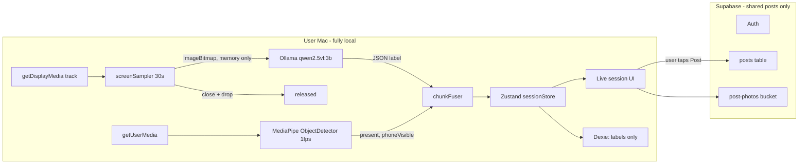

# Focusline: Strava for studying (fully local analysis)

## Goals and non-negotiables

- Every screenshot and webcam frame is analysed on the device: Ollama on `localhost:11434` for the screen, MediaPipe in the browser for the webcam.
- Frames live in memory only, are never written to disk, IndexedDB or the network, and are released straight after analysis (`bitmap.close()`, canvas cleared, references dropped).
- Only the post the user chooses to share goes to Supabase: one live photo plus summary stats.
- The UI looks like Notion, with a modern, animated feel.
- Demo machine: an M-series Mac running the Ollama app. Dev can happen anywhere; set the Ollama URL through `VITE_OLLAMA_URL`.

## Architecture



## Stack

- Vite, React 18, TypeScript, React Router
- Tailwind CSS, shadcn/ui (restyled), lucide-react icons, Framer Motion
- Zustand (live session state) and Dexie (local history, labels only)
- `@mediapipe/tasks-vision` (EfficientDet-Lite0 object detector)
- Ollama `qwen2.5vl:3b` (fall back to `7b` if accuracy is poor and the Mac has 16 GB+ of memory)
- `@supabase/supabase-js`, `html-to-image`, `date-fns`, `cmdk` for the command palette

## Repo layout

```
focusline/
  index.html
  .env.example                 VITE_OLLAMA_URL, VITE_OLLAMA_MODEL, VITE_SUPABASE_URL, VITE_SUPABASE_ANON_KEY
  tailwind.config.ts           Notion palette + fonts
  supabase/schema.sql          tables, RLS, bucket policies
  src/
    main.tsx, App.tsx          router + layout (Notion-style sidebar)
    styles/globals.css         CSS variables (light/dark), fonts
    lib/
      ollama.ts                health check + classifyScreen()
      screenSampler.ts         getDisplayMedia, frame grab, downscale, release
      webcamDetector.ts        MediaPipe loader + 1fps loop
      chunkFuser.ts            combine screen + webcam into 30s chunk labels
      focus.ts                 focus score, breakdown, streak calc
      db.ts                    Dexie schema (modules, sessions, chunks)
      supabase.ts              client + post/feed/friend helpers
      storyCard.ts             html-to-image export 1080x1920
      demoMode.ts              replay recorded chunks for on-stage fallback
    store/sessionStore.ts      Zustand: status, chunks, timer, current label
    components/
      Sidebar.tsx, PageHeader.tsx (emoji icon + cover), Callout.tsx,
      Tag.tsx, BreakdownBar.tsx, SerifTimer.tsx, StatusDot.tsx,
      PrivacyBadge.tsx, Heatmap.tsx, ToggleList.tsx, StoryCard.tsx,
      PostCard.tsx, CommandPalette.tsx, OllamaStatus.tsx
    pages/
      Onboarding.tsx, Home.tsx, Session.tsx, Summary.tsx,
      Feed.tsx, Profile.tsx, Login.tsx
```

## Core logic

### 1. Screen sampler ([src/lib/screenSampler.ts](focusline/src/lib/screenSampler.ts))

- `start()` calls `getDisplayMedia({ video: { displaySurface: "monitor" }, audio: false })`. If the user stops sharing (`track.onended`), pause the session.
- Every 30 s, if no request is already running: `new ImageCapture(track).grabFrame()` gives an `ImageBitmap`. Draw it onto a reusable `OffscreenCanvas` scaled to 1280 px wide, then `convertToBlob({ type: "image/jpeg", quality: 0.7 })` and convert to base64.
- In a `finally` block: `bitmap.close()`, `ctx.clearRect(...)`, and set the base64 and blob variables to null. A counter tracks `framesAnalysed`, and `framesStored` always stays 0 for the privacy badge.
- If `ImageCapture` is missing (Safari), fall back to a hidden `<video>` element plus `drawImage`.

### 2. Ollama classifier ([src/lib/ollama.ts](focusline/src/lib/ollama.ts))

- `checkHealth()` calls `GET /api/tags` and confirms the model is pulled. Its result drives `OllamaStatus.tsx` (green or red dot, with setup instructions).
- `classifyScreen(base64, modules)` calls `POST /api/chat` with `stream: false`, `format: <JSON schema>`, `options: { temperature: 0 }` and `keep_alive: "30m"` so the model stays warm.

```ts
const schema = {
  type: "object",
  properties: {
    studying: { type: "boolean" },
    subject: { type: "string", enum: [...modules.map(m => m.name), "Not study"] },
    activity: { type: "string" },
    confidence: { type: "number" },
  },
  required: ["studying", "subject", "activity", "confidence"],
};
```

- The prompt lists each module with its keywords (entered during onboarding) and says to judge content, not the app. For example, a lecture on YouTube counts as that subject, and social media, games or shopping count as "Not study".
- 20 s timeout through `AbortController`. On error the chunk is labelled `unknown`, which is left out of the focus score.

### 3. Webcam detector ([src/lib/webcamDetector.ts](focusline/src/lib/webcamDetector.ts))

- Load `ObjectDetector` from `@mediapipe/tasks-vision` (EfficientDet-Lite0 float16, GPU delegate, `runningMode: "VIDEO"`, `scoreThreshold: 0.4`).
- Run at 1 fps on a small preview `<video>`. Emit `{ present: hasPerson, phoneVisible: hasCellPhone }`.
- Keep a rolling 30 s window: the share of seconds the person was present and the share with a phone visible.

### 4. Chunk fuser ([src/lib/chunkFuser.ts](focusline/src/lib/chunkFuser.ts))

Each 30 s chunk gets one label:

- No person for more than 20 s of the chunk: `away`, and the timer pauses.
- Phone visible for more than 5 s: `distracted` (reason `phone`).
- The screen says `Not study`: `distracted` (reason `screen`, with the activity text).
- The screen gives a subject: that subject.
- The screen call failed: `unknown`.

Stored chunk: `{ sessionId, startedAt, label, reason, activity, confidence }`. Labels only, never images.

### 5. Metrics ([src/lib/focus.ts](focusline/src/lib/focus.ts))

- `focusPct` = subject chunks divided by (all chunks minus `away` and `unknown`).
- `breakdown` = minutes per subject plus distracted minutes, shown as percentages.
- `streak` = consecutive days, ending today or yesterday, with at least one session of 15+ minutes (from Dexie).
- The user can relabel any chunk in the Summary toggle list before posting.

### 6. Always-on-top floating timer ([src/components/FloatingTimer.tsx](focusline/src/components/FloatingTimer.tsx), [src/lib/pip.ts](focusline/src/lib/pip.ts))

A small window that stays on top of every app while the student works elsewhere.

- Uses the Document Picture-in-Picture API (Chrome/Edge 116+): `await documentPictureInPicture.requestWindow({ width: 280, height: 120 })`. Chrome opens it in a screen corner, and the user can drag it.
- `pip.ts` copies the app's stylesheets into `pipWindow.document`, then renders `<FloatingTimer />` into `pipWindow.document.body` with a React portal. It's the same JS context, so it reads the same Zustand store with no syncing.
- Content:
  - Serif timer.
  - Status pill: green "Studying Biology", red "Distracted - Instagram", grey "Away".
  - Pause and End buttons.
  - Whole-window background tint: soft Notion green or red, fading over 300 ms.
- It needs a user click to open. Request the PiP window first in the "Start session" click handler, then call `getDisplayMedia`. If that combined call fails, show a "Pop out timer" button on the Session page as a fallback.
- When the session ends, call `pipWindow.close()`. Handle the `pagehide` event when the user closes it manually, and offer to reopen it.
- Fallback for Safari and Firefox: draw the timer onto a canvas, `canvas.captureStream()` into a hidden `<video>`, and call `video.requestPictureInPicture()`. This is a stretch goal; the demo runs on Chrome.
- **Hover hub.** A PiP window can only resize itself after a click (`pipWindow.resizeTo()` needs user activation; hover doesn't count). So:
  - Open it at 300x170, big enough for the compact view and the hub.
  - Compact view (default): timer, status pill, Pomodoro phase dots.
  - On hover (`mouseenter` on the PiP body), a Framer Motion panel slides up over the timer within the same window:
    - Row 1: Pomodoro play/pause, skip phase, preset chip (25/5, 50/10, custom).
    - Row 2: sound chips (Off, White, Pink, Brown, Rain, Cafe), each a Notion-style tag, plus a volume slider.
    - Row 3: Pause session, End session.
  - `mouseleave` hides the panel after 600 ms, so it doesn't flicker when the mouse brushes past.
  - Optional: an "Expand" button calls `pipWindow.resizeTo(360, 420)` on click for a fuller hub (today's breakdown bar, session log). Shrink back on the next click.

### 7. Distraction alerts ([src/lib/alerts.ts](focusline/src/lib/alerts.ts))

- Ask `Notification.requestPermission()` during onboarding.
- Escalation, based on consecutive `distracted` chunks:
  - 1 chunk (30 s): the floating timer turns red, nothing else.
  - 2 min: a system notification, "You've been on Instagram for 2 min - back to Biology?", plus a soft chime played in the PiP window.
  - 5 min: a second notification, and the floating timer pulses.
  - The alert resets as soon as a study chunk arrives. That return gets a small green "Back on track" flash.
- No alerts for `away`. The timer just pauses and shows "Away".
- A setting to turn sound on or off, and a "focus strictness" choice (2 / 5 / 10 min thresholds).
- During Pomodoro breaks, no alerts fire (see section 8).

### 8. Pomodoro ([src/lib/pomodoro.ts](focusline/src/lib/pomodoro.ts), part of `sessionStore`)

- Presets: 25/5 (long break 15 after 4 rounds), 50/10, and custom. Pomodoro is optional; the session can also run as a free timer.
- Store state: `pomodoro: { enabled, phase: "focus" | "break" | "longBreak", round, phaseEndsAt, preset }`. Use `phaseEndsAt` timestamps rather than counting ticks, so the timer stays accurate when Chrome throttles background tabs.
- At each phase change: a system notification ("Break time - 5 min" / "Back to focus - round 3"), a chime, and the PiP tint turns blue for breaks.
- **During breaks:** screen sampling and webcam checks pause, nothing is analysed, and break time is left out of the focus score and breakdown. This is a nice privacy line for the pitch: "On breaks, it stops looking."
- Session totals count only focus time. Rounds completed go on the story card ("4 pomodoros").

### 9. Ambient sound ([src/lib/sound.ts](focusline/src/lib/sound.ts))

- One `AudioContext` in the main window. It keeps playing when the tab is in the background or the PiP window is focused.
- **Generated noise, no files:** white, pink and brown noise made in code (a looping 2-second `AudioBuffer` filled with filtered random samples), feeding a `GainNode` for volume. Tiny, instant and works offline.
- **Optional loops:** `public/sounds/rain.mp3` and `cafe.mp3` (CC0, under 1 MB each), played through `AudioBufferSourceNode` with `loop = true`.
- Crossfade 400 ms when switching sounds. Fade to 30% volume during breaks, or play a different sound if the user picks one.
- The selected sound and volume are saved in `localStorage`. The AudioContext starts on the first user click (the "Start session" button counts).

## Data

### Local, in Dexie ([src/lib/db.ts](focusline/src/lib/db.ts))

- `modules(id, name, color, keywords[])`
- `sessions(id, startedAt, endedAt, durationS, focusPct, breakdown)`
- `chunks(id, sessionId, startedAt, label, reason, activity, confidence)`

### Cloud, in Supabase ([supabase/schema.sql](focusline/supabase/schema.sql))

- `profiles(id uuid pk references auth.users, username text unique, avatar_url text)`
- `friendships(user_id, friend_id, status text check in ('pending','accepted'), created_at)`
- `posts(id, user_id, photo_path, duration_s, focus_pct, breakdown jsonb, streak int, caption text, created_at)`
- Storage bucket `post-photos`.
- Row-level security:
  - Users can insert and delete only their own posts.
  - Posts are readable by the author and by accepted friends, in either direction of the friendship.
  - Photo storage follows the same rule.
- Login: email magic link, or username plus password for speed at the demo.

## Pages and UX

1. **Login and Onboarding:**
   - Pick a username.
   - Add modules in a Notion-style editable table: name, tag colour picker, keywords.
   - Ollama health card: a green dot, or the exact setup commands if it's not running.
2. **Home:**
   - Page header with an emoji icon and a cover image.
   - A big "Start session" button, also reachable with `Cmd+K` and then "Start session".
   - Streak counter, weekly heatmap, and recent sessions as a toggle list.
3. **Session (live):**
   - A large serif timer with a Framer Motion number roll.
   - A small rounded webcam preview with a status dot.
   - A callout reading "Last check: Biology - reading lecture slides".
   - An animated breakdown bar made of coloured tag segments.
   - A privacy badge: "Screenshots analysed: 14 - stored: 0".
   - Pause and End buttons.
4. **Summary:**
   - Duration, focus % and breakdown, with each chunk in an editable toggle list for relabelling.
   - A live webcam photo with a countdown and no gallery upload.
   - A story card preview, plus "Post to friends" and "Download for Instagram" buttons.
5. **Feed:** friends' posts as Notion-style cards (photo, name, duration, breakdown tags, streak, time ago).
6. **Profile:** heatmap, totals per subject, add friend by username, and pending friend requests.

## Notion-inspired design system

- **CSS variables:**
  - Light theme: `--bg #FFFFFF`, `--sidebar #F7F6F3`, `--text #37352F`, `--muted #787774`, `--border #E9E9E7`, `--hover #EFEFED`.
  - Dark theme: `--bg #191919`, `--sidebar #202020`, `--text #FFFFFFCF`.
- **Tag palette:** Notion's colours (gray, brown, orange, yellow, green, blue, purple, pink, red), each as a light background with darker text. Used for subjects, the breakdown bar and post tags.
- **Fonts:** Inter for body text. Instrument Serif or Newsreader for page titles, the timer and the story card.
- **Components:**
  - 3–4 px corner radius, hairline borders, almost no shadows.
  - Hover backgrounds on rows.
  - Emoji page icons and a cover image strip.
  - Callouts, toggle lists, and a `/`-style command palette via `cmdk`.
- **Motion:**
  - 150–250 ms ease-out fades and slides between pages.
  - Breakdown segments animate their width with springs.
  - The status dot pulses.
  - The story card reveals with a soft scale-in.
- **Story card:** 1080×1920, off-white Notion page look with a big serif duration ("2h 14m"), focus %, a stacked subject bar, a streak badge, the user's photo in a rounded frame, and a "Focusline" wordmark. A dark variant is optional.

## Story export ([src/lib/storyCard.ts](focusline/src/lib/storyCard.ts))

- `toPng(node, { width: 1080, height: 1920, pixelRatio: 1 })` renders a hidden `StoryCard`.
- On desktop, download the PNG. If the browser supports `navigator.canShare({ files })`, open the share sheet instead.
- Also offer "Send to phone": the post exists in the feed, so the user can open it on their phone and share it to Stories from there.

## Setup commands (demo Mac)

```bash
ollama pull qwen2.5vl:3b
launchctl setenv OLLAMA_ORIGINS "http://localhost:5173"
# quit and reopen the Ollama app
npm create vite@latest focusline -- --template react-ts
npm i @mediapipe/tasks-vision @supabase/supabase-js dexie zustand framer-motion html-to-image cmdk date-fns react-router-dom lucide-react
npx tailwindcss init -p   # then shadcn init
```

## Team split (5 people)

| Person | Owns |
|---|---|
| 1 | `screenSampler.ts`, `ollama.ts`, the prompt, accuracy tests on 10 real screenshots in the first hour, then `sound.ts` |
| 2 | `webcamDetector.ts`, `chunkFuser.ts`, `focus.ts`, `alerts.ts`, `pomodoro.ts` |
| 3 | Design system, Sidebar, Session page, BreakdownBar, SerifTimer, motion, FloatingTimer (PiP) and its hover hub |
| 4 | Supabase schema and RLS, auth, Feed, Profile, Summary, StoryCard and export |
| 5 | Notion Hackathon HQ, pitch deck, demo script, `demoMode.ts`, floater help and QA |

## Timeline

- **2:20–2:50:** scaffold, theme and fonts, Supabase project and schema, Ollama pulled and CORS set. Person 1 runs the accuracy test.
- **2:50–4:00:** samplers, classifier and fuser working against a debug panel. Session page built on mock data. Login works.
- **4:00–4:20:** lunch, then wire the real store into the Session page.
- **4:20–5:15:** Summary, live photo, story card, feed, friends, streaks, privacy badge.
- **5:15–5:25:** polish, dark mode if there's time, run through `demoMode.ts`.
- **5:25:** code freeze. Rehearse the demo twice.

## Demo script (about 2 minutes)

1. Start a session with Biology slides open, and the callout shows Biology.
2. Switch to a maths PDF, and a new colour grows in the breakdown bar.
3. Open Instagram. The floating timer in the corner turns red and reads "Distracted - Instagram", and a notification fires after a short demo threshold.
4. Pick up your phone, and it's flagged as distracted (phone).
5. End the session, relabel one chunk, take the live photo, post it, and it appears in a teammate's feed. Download the story card.
6. Closing line: "Every frame was analysed on this laptop and deleted within seconds. Screenshots stored: 0. Only the post you chose to share left the device."

## Cut order if behind schedule

Drop from the top down:

1. Rain and cafe loops (keep only the generated noise)
2. The PiP "Expand" view
3. Dark mode
4. The `Cmd+K` palette
5. Custom Pomodoro presets (keep 25/5)
6. The Profile page
7. Accepting friend requests (auto-accept)
8. Chunk relabelling

Never cut: the live Session page, the floating timer with green/red status, the privacy badge, the story card.

## Risks and fallbacks

- **The model mislabels screens:** add module keywords, try `qwen2.5vl:7b`, and lower the confidence needed to fall back to `unknown`.
- **Classification is slow:** move to a 60 s interval, downscale to 1024 px, and keep the model warm with `keep_alive`.
- **CORS or local-network access is blocked:** check `OLLAMA_ORIGINS`, and accept Chrome's local network prompt.
- **Frame grabs fail in background tabs:** test in the first hour. Use `ImageCapture` from the track, which doesn't depend on rendering.
- **The PiP window doesn't open on Start:** the click's user activation may already be used up by `getDisplayMedia`. Use the separate "Pop out timer" button, and test this before 3:30.
- **Something breaks live:** a hidden toggle (`?demo=1`) starts `demoMode.ts`, which replays a recorded chunk list.
- **Supabase is down or the venue Wi-Fi is bad:** the feed shows cached posts, and the local session flow still works fully offline.
